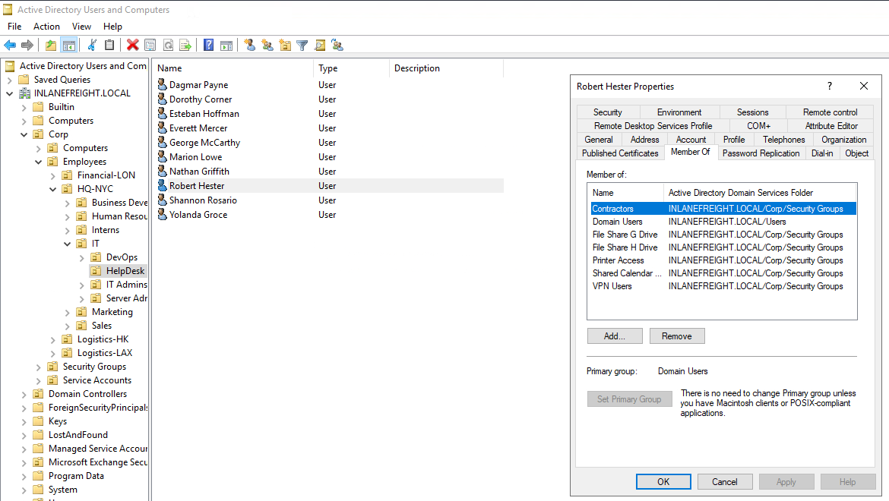
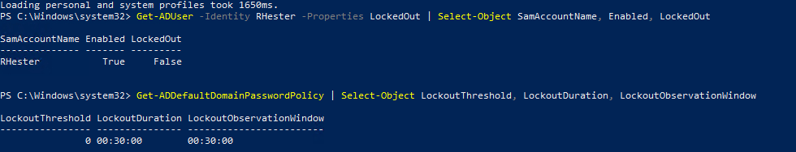

# Active Directory Help Desk Lab

**Alperen Metin** · November 2026

I investigated three help desk cases in the INLANEFREIGHT.LOCAL training domain using Active Directory Users and Computers, PowerShell, smbclient and DNS tools.

[Read the illustrated PDF report](active-directory-helpdesk-report.pdf)

| Case | Symptom | Verified outcome |
| --- | --- | --- |
| Account recovery | Test account locked | Directory query succeeded with the recovered credentials |
| SMB authorization | Directory listing denied | Same user listed the share after a group-based NTFS change |
| DNS resolution | Public resolver returned NXDOMAIN | Same user listed the share by hostname through the client’s default resolver |

## Lab environment

The Windows domain controller hosted the Finance-Lab SMB share. I used a Parrot Linux client over the HTB lab VPN. The host identified itself in DNS as `ACADEMY-EA-DC01.INLANEFREIGHT.LOCAL`.

## 1. Recover a locked domain account

**Establish a baseline.** I checked RHester in Active Directory Users and Computers and PowerShell. The account was enabled and unlocked. The default domain lockout threshold was 0, so I created a separate account, lab-lockout-test, to exercise the lockout workflow.

**Reproduce and diagnose.** I assigned Lab-Lockout-Test-Policy to the test account. Its effective settings were three failed attempts, a five-minute observation window and a fifteen-minute lockout. The sign-in tests returned error 1326 for incorrect credentials, followed by 1909 for a locked account. Get-ADUser confirmed the account was still enabled.

**Restore and verify.** I ran Unlock-ADAccount and checked LockedOut again. A subsequent runas attempt returned 1385, indicating the account lacked that logon right on the host. I verified the credentials with a directory query under the test account. The query returned its own account name.

| Evidence from the captures | Observed result |
| --- | --- |
| Before unlock | `Enabled = True    LockedOut = True` |
| After unlock | `Enabled = True    LockedOut = False` |
| Credential check | `Get-ADUser returned lab-lockout-test` |

The credential check establishes directory authentication. Interactive sign-in on the domain controller remained restricted.

## 2. Restore access to a finance share

**Reproduce the denial.** I created Finance-Lab at C:\Shares\Finance-Lab and connected from Parrot with the domain account finance-lab-user. I used the server IP to test permissions independently of DNS. The SMB client reached the share, but listing its contents returned NT_STATUS_ACCESS_DENIED.

**Apply group-based access.** I granted the domain group Finance-Lab-Read the NTFS Read & execute permission on the Finance-Lab folder and added finance-lab-user to that group. The ACL showed (OI)(CI)(RX): the entry applied to the folder and could be inherited by files and subfolders.

**Repeat the user test.** I opened a fresh SMB connection to the same IP and share with finance-lab-user and repeated ls. The listing returned the current and parent directory entries. This verified directory listing with the test account.

| Evidence from the captures | Observed result |
| --- | --- |
| First listing | `NT_STATUS_ACCESS_DENIED listing \*` |
| NTFS entry | `INLANEFREIGHT\Finance-Lab-Read:(OI)(CI)(RX)` |
| Second listing | `.    D                  ..    D` |

The directory was empty. File-content reads, file creation and write denial were outside the recorded test.

## 3. Resolve the share by hostname

**Compare resolvers.** The Parrot client asked 1.1.1.1 for ACADEMY-EA-DC01.INLANEFREIGHT.LOCAL and received NXDOMAIN. Querying the lab DNS server directly at 10.129.202.146 returned two IPv4 addresses for the same name. This isolated the issue to the choice of DNS resolver.

**Route the lab zone.** I started a temporary dnsmasq listener on 127.0.0.1 and configured it to forward inlanefreight.local queries to 10.129.202.146. I backed up the client resolver configuration and pointed it at the local listener.

**Verify the user workflow.** A fresh A-record lookup using the default resolver returned both IPv4 addresses. I then opened Finance-Lab using the fully qualified hostname and the same finance account. The SMB directory listing succeeded.

| Evidence from the captures | Observed result |
| --- | --- |
| Public DNS | `1.1.1.1  ->  NXDOMAIN` |
| Default DNS after change | `127.0.0.1  ->  172.16.6.5 and 10.129.202.146` |
| SMB via hostname | `Finance-Lab  ->  directory listing returned` |

The client-side change was temporary. The final capture shows successful DNS and SMB tests. A resolver rollback was not captured.

## Credits

Lab environment provided by Hack The Box Academy in *Introduction to Active Directory*. Investigation, screenshots and report by Alperen Metin.
